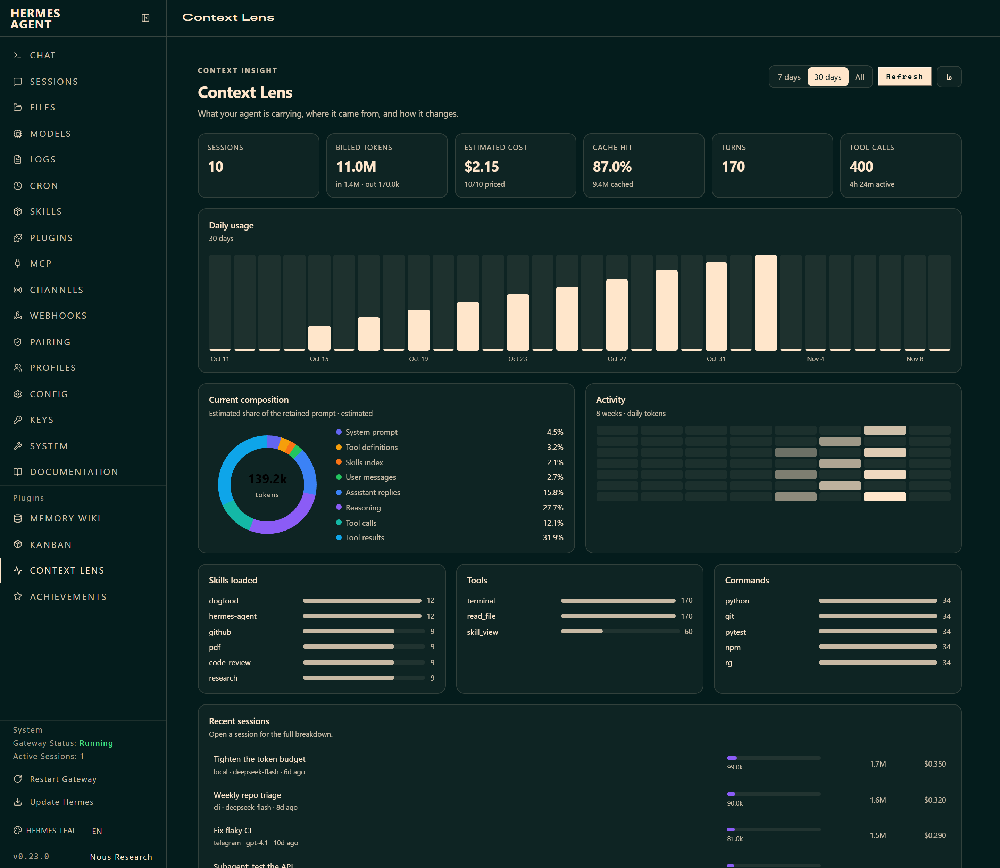
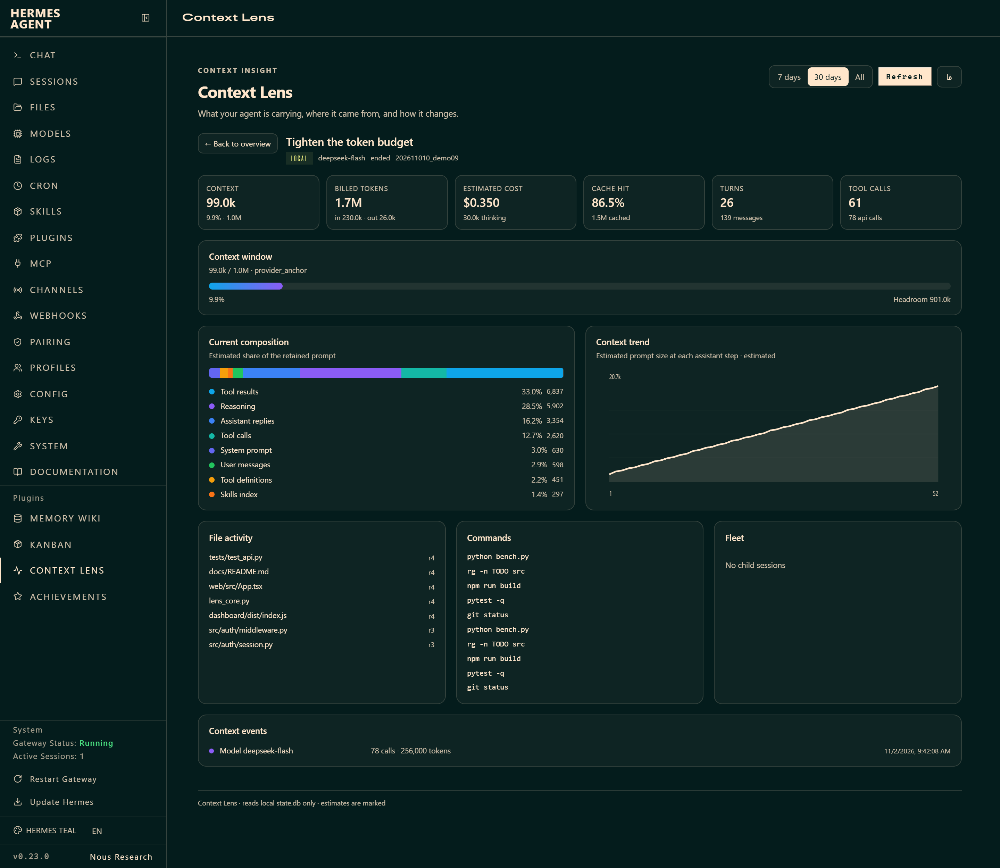

<div align="center">

<picture>
  <source media="(prefers-color-scheme: dark)" srcset="docs/logo-dark.svg">
  
</picture>

### See what your agent is carrying.

Context insight for Hermes Agent — token composition, context trends, skills, tools, commands, and the agent fleet.

<p>
  <a href="https://github.com/Farzin-CS/hermes-context-lens/releases"></a>
  <a href="https://github.com/Farzin-CS/hermes-context-lens/blob/main/LICENSE"></a>
  <a href="https://github.com/NousResearch/hermes-agent">= 0.22"></a>
  <a href="https://github.com/Farzin-CS/hermes-context-lens"></a>
  <a href="https://github.com/Farzin-CS/hermes-context-lens/stargazers"></a>
</p>

<p>
  <a href="#install">Install</a> ·
  <a href="#quick-start">Quick start</a> ·
  <a href="#what-you-get">What you get</a> ·
  <a href="#how-it-works">How it works</a> ·
  <a href="#performance">Performance</a> ·
  <a href="#development">Development</a>
</p>



</div>

---

**Context Lens** is a Hermes Agent plugin that turns the local session database into a context dashboard. It answers the questions a token counter cannot: what is inside the window right now, which part is growing, what the agent did with it, and how the context evolved step by step.

It reads `state.db` directly — read-only, already recorded, no instrumentation. Every session Hermes has written is available immediately, including the one you are in.

## Why Context Lens

- **See the whole window, not one number.** System prompt, tool schemas, skills index, user messages, injected context, assistant replies, reasoning, tool calls and tool results — with an estimated share for each.
- **Find what actually eats the context.** In a long agent session the answer is usually tool results, not the conversation. Context Lens makes that visible instead of leaving you with a single percentage.
- **Follow the session over time.** The trend view estimates the prompt size at every assistant step, so a sudden jump has a step number and a timestamp.
- **Know what the agent did.** Loaded skills, tool calls, command executions, exit codes and file activity are collected from the transcript, not from a separate log.
- **Watch the family.** Parent sessions, child sessions and async delegations are shown together, with each child's token count and context pressure.
- **Stay local.** No network calls, no telemetry, no extra database. The plugin only reads files Hermes already wrote.

## Install

```bash
hermes plugins install Farzin-CS/hermes-context-lens --enable
```

Open the dashboard and choose **Context Lens** in the sidebar:

```bash
hermes dashboard
```

In chat, type:

```text
/lens
```

<details>
<summary>Manual install</summary>

```bash
git clone https://github.com/Farzin-CS/hermes-context-lens \
  ~/.hermes/plugins/context-lens
hermes plugins enable context-lens
```

On Windows the default Hermes home is `%LOCALAPPDATA%\hermes`; the plugin directory is `%LOCALAPPDATA%\hermes\plugins\context-lens`.

</details>

## Quick start

Three entry points, one data model.

```bash
hermes context-lens                    # last 30 days
hermes context-lens overview --days 7
hermes context-lens overview --days 0  # all time
hermes context-lens session <id>       # one session
hermes context-lens session --json     # machine-readable
```

```text
/lens                  current session, compact
/lens full             full session view
/lens overview 30      30-day window
/lens session <id>     another session
```

The terminal view is deliberately plain text — it works over SSH, in the classic CLI, and in the TUI:

```text
Context Lens - last 7 days
================================

Sessions 12 · Turns 84 · Tool calls 431 · Active 3h 18m
Billed 48.2M tokens · est. $1.84 · cache hit 94.1%
In 6.1M · Out 712k · Cache 41.4M

Usage
  Nov 03  ███                      2.1M
  Nov 04  ████████████            8.6M
  Nov 05  ██████                  4.2M
  ...

Current context composition (estimated)
  Tool results       ██████           41.2%  183k
  Reasoning          ███              21.8%  97k
  Tool definitions   ██               14.9%  66k
  ...
```

## What you get

| Surface | What it shows |
|---|---|
| **`/lens`** | The current session at a glance: context gauge, token split, composition, loaded skills, and fleet. Works in CLI, TUI, Desktop, Telegram, Discord, and the rest of the gateway. |
| **`hermes context-lens`** | Cross-session dashboard in the terminal: KPI, daily usage, skills/tools/commands, file activity, and a session list. `--json` for scripts. |
| **Dashboard tab** | The visual version: KPI cards, daily chart, 8-week activity heatmap, composition donut, skill/tool/command ledgers, session table, and full session detail. |
| **English + فارسی** | The dashboard tab ships an English UI and an RTL Persian UI. The toggle is in the page header. |

### Session detail



The detail view adds:

- **Context window** — provider-anchored prompt size when Hermes recorded one; otherwise a labelled estimate, resolved against the model's real window.
- **Context trend** — estimated prompt size at every assistant step.
- **Context events** — session resets, parent continuation, compaction summaries and model changes.
- **File activity** — reads, writes and edits per path.
- **Commands** — shell and code executions, with exit codes when the tool result recorded one.
- **Fleet** — parent session, child sessions, and async delegations.

## How it works

```text
state.db (read-only)
├── sessions / messages / system prompts / tool schemas
├── session_model_usage / async_delegations
└── Hermes' own indexes
          │
          ▼
      lens_core
      ├── /lens ─────────────── chat: CLI, TUI, Desktop, Telegram, Discord
      ├── hermes context-lens ─ terminal + JSON
      └── dashboard API ─────── Context Lens tab
```

`lens_core` is a small stdlib Python module. It reads the database with `mode=ro`, aggregates the fields Hermes already stores, and estimates token sizes with the same byte-aware approach as Hermes' own `/context` command.

The current-context number prefers `model_config._usage_anchor.prompt_tokens` — the provider's own measurement — and falls back to the composition estimate only when no anchor exists. That distinction is shown in the UI, not hidden.

## Performance

Benchmarked on a synthetic Hermes-format database: **500 sessions, 100,000 messages, 260 MB**, with Hermes' indexes applied (they matter: without them, per-session composition queries fall back to full scans).

| Operation | Time (Python 3.14, warm cache) |
|---|---|
| `overview(days=30)` — 100k messages | **~1.2 s** |
| One session detail — 200 messages | **~1–2 ms** |
| SQL-only scan of all message content | ~0.53 s |
| 30k tool-call JSON parses | ~0.24 s |

The overview is dominated by SQLite reading message content for token estimates, not by Python. A Rust/native rewrite would remove roughly the 0.7 s of Python/JSON work while the ~0.5 s of database I/O remains — not worth the packaging cost for a plugin. The next scaling limit is the per-session composition query at thousands of sessions; batching that is the optimization to make if it ever matters.

## Configuration

| Setting | What it does |
|---|---|
| `hermes context-lens --db PATH` | Read another profile or a copy of a database. |
| `CONTEXT_LENS_DB=PATH` | Same override for the dashboard backend, useful for demos and tests. |
| `--days N` | Window in days; `0` means all time. |
| `--source telegram` | Filter by platform (`cli`, `telegram`, `discord`, …). |
| `--all` | Include archived sessions. |
| `--json` | Emit the report as JSON. |

## Data and accuracy

- **Composition and trend are estimates.** Hermes does not persist a per-request token ledger for historical sessions, so categories use the byte-aware estimate family used by `/context`.
- **Daily attribution is approximate.** Session totals are distributed across assistant-step timestamps; a session with one API call has one bucket.
- **Command exit codes are best-effort.** They are parsed from the stored tool result; a tool that never reports one shows as unknown.
- **Injected memory is not persisted** in the transcript by Hermes, so it is counted only when it appears in a stored message or system prompt.
- **Archived sessions are excluded by default.** Pass `--all` to include them.

## Development

No build step. Python uses the standard library; the dashboard bundle is plain JavaScript (React comes from the dashboard SDK). PyYAML is used only when present, to read Hermes' model-length cache and config.

```bash
python -m unittest discover -s tests -v
hermes plugins doctor . --ci
hermes plugins validate .
```

Run the dashboard against another database:

```bash
CONTEXT_LENS_DB=/path/to/state.db hermes dashboard --port 9123
```

## Contributing

Issues and pull requests are welcome. Before opening a PR, run:

```bash
python -m unittest discover -s tests -v
hermes plugins doctor . --ci
hermes plugins validate .
```

## Compatibility

- Hermes Agent **>= 0.22.0** (tested on 0.22.5 / 0.23.0).
- Python 3.10+.
- Uses documented plugin surfaces: `register_cli_command`, `register_command`, the dashboard `manifest.json` + `plugin_api.py` API.

## Privacy

Everything is local. The plugin has no network calls and no telemetry. The JSON output and dashboard necessarily contain session titles, working-directory paths and command lines — treat exports accordingly.

## Credits

- Inspired by [`bowenliang123/dsh-context`](https://github.com/bowenliang123/dsh-context) (Apache-2.0), the context dashboard for DeepSeek Harness. This is an independent Hermes implementation, not a code port.
- Built for [Hermes Agent](https://github.com/NousResearch/hermes-agent) by Nous Research.

## License

MIT — see [LICENSE](LICENSE).
